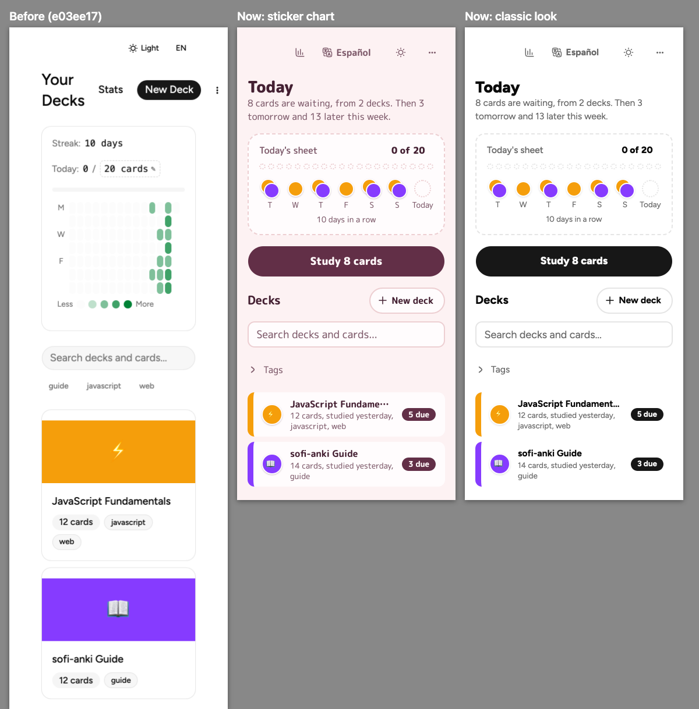
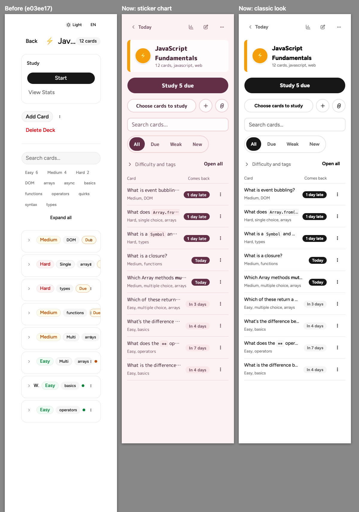
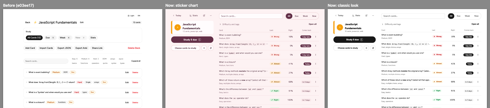
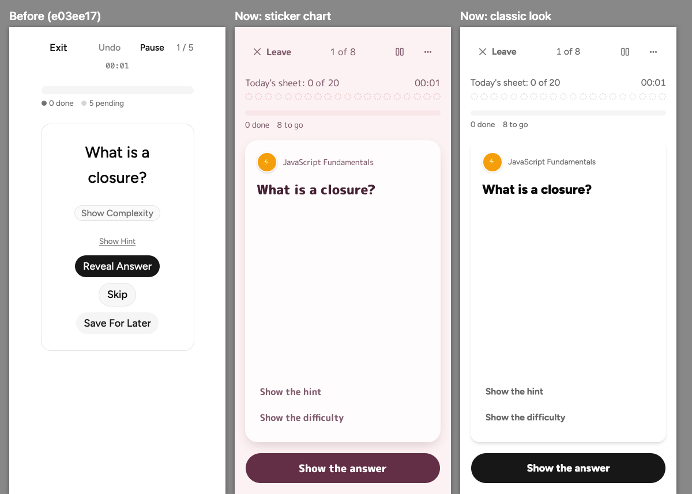
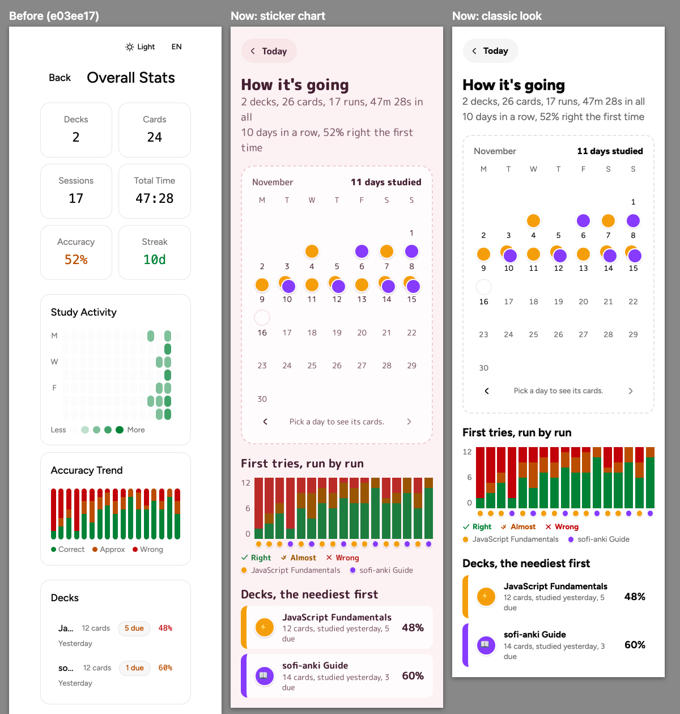

# Before and after the sticker chart, screen by screen

The owner's girlfriend dislikes the restyle (`A12`, the sticker-chart direction): its colours and font, and its layout and flow. This compares the app before it with the app now, so the two can be merged. It was made on 2026-11-16.

Each image has three columns, all on the same demo data:

- Before: the app at e03ee17, the last commit before a71ddaa gave the app the sticker chart.
- Now: sticker chart: `dev` at 41b3d25, in the default look.
- Now: classic look: the same build with the classic look (`A14`, chosen from home's More menu). It has the old colours and Figtree, on the new layout.

Every screen is in `old-new/` as `<screen>.<phone|laptop>.<light|dark>.png`. The phone is 375 px wide and shot full length. The laptop is 1280 by 800.

## Home

| | Before | Now |
|---|---|---|
| Title | "Your Decks" | "Today", with a line on what is due today, tomorrow and later this week |
| Progress | A streak line, today's count against the goal, and a 3-month heatmap in green | Today's sheet: one spot per card of the goal, with the week's stickers |
| Studying | Opened from a deck, which offered All, Due, Weak and New | One "Study 8 cards" button across every deck with cards due |
| Decks | A grid of cards, each with a big cover in the deck's colour and its emoji | A list ranked by due, each row with a coloured spine, a round sticker and a due badge |
| Top bar | Theme and language as words, Stats and New Deck beside the title | Icons for stats, language, theme and More |

## A deck's page

| | Before | Now |
|---|---|---|
| Study | A "Study" box of pills: All cards, Due, Weak, New, then a dialog for shuffle and a goal | "Study 5 due", and "Choose cards to study" for the rest |
| Actions | A row of text buttons: Add Card, Import, Export JSON, Export Anki, Share Link, Delete Deck | Icons for add and share, the rest under More |
| Cards | Rows that unfold, with difficulty, tags and Due as coloured pills, Edit and Delete on each | A table: the card, its last grade, how often it was right, when it comes back, and a menu |

## Studying

| | Before | Now |
|---|---|---|
| Card | Centred text in a plain box, the difficulty as a pill under the question | Left-aligned, with the deck's sticker and name on top and a dashed rule under the question |
| Grades | Three wide buttons (Wrong, Approximate, Correct), then "Next" | Three round stamps (Wrong, Almost, Right) that grade and move on in one step, each saying when the card comes back |
| Ask again | A "Redo later" checkbox | "Ask it again in this run": If not right, Yes, No |
| Laptop | One column | The run's time, tally and actions in a side panel, each with its key |

## Stats

| | Before | Now |
|---|---|---|
| Totals | Six tiles: decks, cards, sessions, time, accuracy, streak | One line of the same numbers |
| History | The green heatmap and an accuracy-trend chart | A month calendar of stickers and a chart of first tries per run |
| Decks | A plain table | Rows like home's, ranked by the lowest first-try rate |

## What the classic look already brings back, and what it does not

It brings back the white and near-black neutrals, the black buttons, Figtree, and the old corners and shadows, in light and dark.

Everything else is the sticker chart. The headings stay extra-bold, where the old ones were regular weight. The rest of what is left:

- the dashed sheet and its spots on home and in studying
- the round stamps
- the deck list in place of the cover grid
- the "Today" home and its one Study button
- the stats calendar

## Ways to merge them

Each step below goes further than the one before, and costs more.

1. She uses the classic look. It exists and costs nothing. Check first whether she has seen it: it is hidden in home's More menu by design. If the colours were most of her objection, this may be enough.
2. Bring the classic look closer to the old app. Headings at regular weight, the sheet's dashed borders solid and quiet, and the stamps as flat rectangles, all under `.classic` alone. This answers "colours and font" fully. The layout stays. It is a few hours of work, and the census already counts both looks.
3. Bring back old layout pieces for everyone. Choose the pieces she misses, one by one. For example: the deck grid with big colour covers as a view home can switch to, the heatmap on stats beside the calendar, the All, Due, Weak and New pills on a deck's page. Each piece then belongs to the app in both looks, so nothing doubles. This needs her to name which pieces matter.
4. A new default that takes from both. The old palette and covers with the new Today home, one-step stamps and deck table. This replaces `A12` and needs the owner's decision. The restyle's work on features carries over, because everything `restore.md` brought back is behaviour.

Keeping the old screens whole beside the new ones was set aside under `A14`, since it would mean two versions of every screen against `C1`. That still holds.

The next step is to show her these images and ask, screen by screen, which column she prefers and what about it. Step 3 depends on her answers, and the choice between steps 2 and 4 is the owner's.
